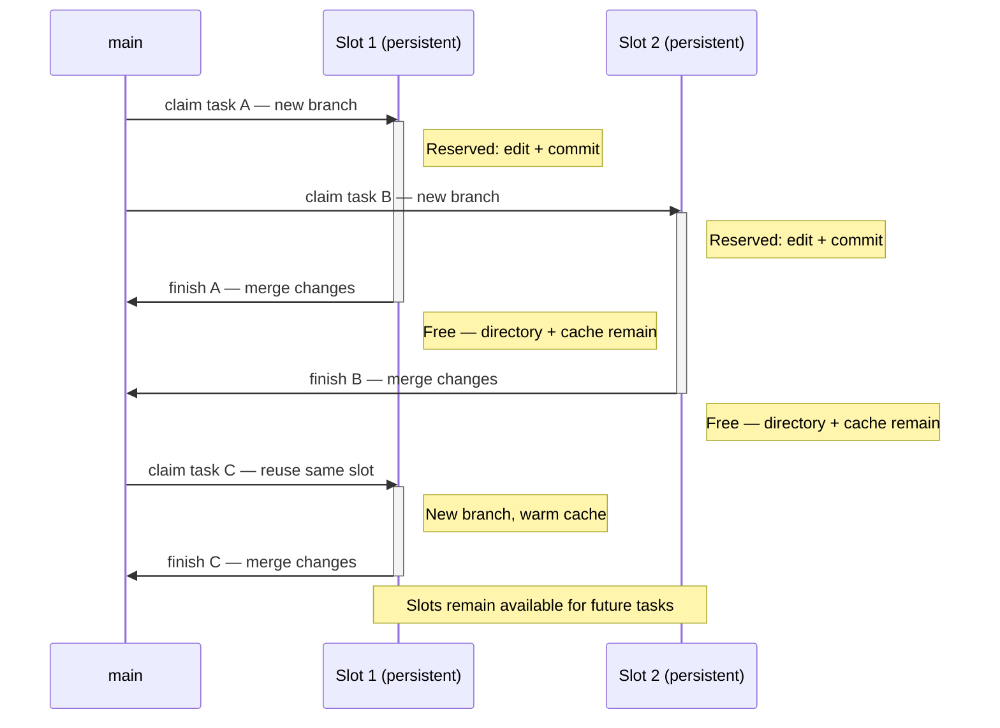

# Git Worktree Slot Skill

Persistent worktree slots with per-task branches and preserved build caches.

For commands and agent instructions, see [SKILL.md](SKILL.md).

## Why use slots?

Work in isolated task branches without recreating worktrees and build caches for every task.

### Pros

- Reuse build caches between tasks, especially useful for Rust.
- Create worktrees only when more slots are needed.
- Keep agent instructions short; the script handles locking and safety checks.

### Cons

- Each slot needs its own checkout and build cache; Git history is shared.
- Ignored runtime data persists too and may affect later tests or previews.

## Opt-in activation

The skill is not active by default. Request it explicitly or make slots the repository default in `AGENTS.md`:

```md
For coding tasks, use the worktree-slot skill.
```

## How it works

1. **Claim:** reserve a free slot and create a task branch from local `main`. If all slots are busy, create another worktree.
2. **Work:** edit and commit in the claimed slot. Other tasks can work in their own slots in parallel.
3. **Finish:** merge the task into local `main` (squashed by default), then release the slot.
4. **Reuse:** the next task or agent claims the **same directory**, with a new branch and the existing build cache.



**Finish never deletes the worktree.** It removes the `.task` reservation; the task branch, `target/` and other ignored files remain. `discard` also releases the slot, but deletes the task's work and branch.

## Technical details

### Requirements

- Bash with associative arrays, Git, `flock`, GNU `realpath` and `date` (as on Linux).
- Main checkout on local `main`; run the installed `slot.sh` from the repository or a slot.
- Keep `.worktrees/`, `.task` and build caches ignored.

### Optional hooks

- Add scripts beside `slot.sh` in `hooks/post-claim/` or `hooks/post-finish/`.
- Any language with a shebang; make scripts executable with `chmod +x`.
- Run automatically in filename order; empty folders, subdirectories and non-executable files are skipped.
- Arguments: `<absolute-slot-path> <feature-branch>`. Working directory: main checkout. Output: stderr.
- **Post-claim:** after reservation; stop on failure and keep the slot reserved.
- **Post-finish:** after merge and release; warn on failure and continue. No hooks on discard.
- Print `Next action: ...` for follow-up work the agent should handle, such as loading another skill.
- After failure, rerun the failed script with the same arguments from main; for claim, also run the remaining scripts. Do not reclaim or remove `.task`.
- Hooks run under the slot lock; do not call slot commands recursively.

### Checks

Run the integration tests in temporary repositories:

```sh
python3 -B -m unittest discover -s .agents/skills/worktree-slot/tests -v
```
